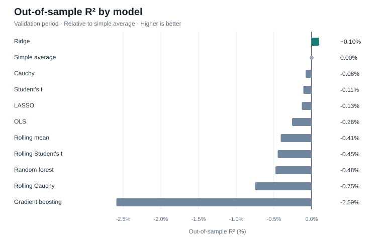

# Statistical vs. Machine Learning Methods for Financial Forecasting

Predicting next-day SPY ETF log returns using historical price and volume data (2010–2026).

**[Full analysis](https://nbviewer.org/github/minjee-kim/financial-forecasting/blob/main/analysis.ipynb)**

## Models

- **Statistical benchmarks:** Historical mean, Student's $t$, Cauchy; fixed and 252-day rolling estimates
- **Linear:** OLS, Ridge, LASSO
- **Machine learning:** Random forest, gradient boosting

The models use 14 candidate price- and volume-based features, a chronological 60/20/20 split, and five-fold time-series cross-validation for hyperparameter tuning.

## Results

On the **2020–2023 validation period** (838 observations), Ridge had the lowest RMSE (**0.015338**) versus **0.015346** for the historical mean. Its out-of-sample $R^2$ was just **0.0010**. Rolling Student's $t$ had the lowest MAE (**0.010244**), and random forest had the highest directional accuracy (**54.65%**).

**None of the more complex methods meaningfully improved next-day return forecasts over the historical mean.** These are validation results; the final 2023–2026 test period has not been evaluated.

## Code

[Research notebook](analysis.ipynb) · [Model implementations](src/models/) · Python, pandas, SciPy, scikit-learn, matplotlib, yfinance.
